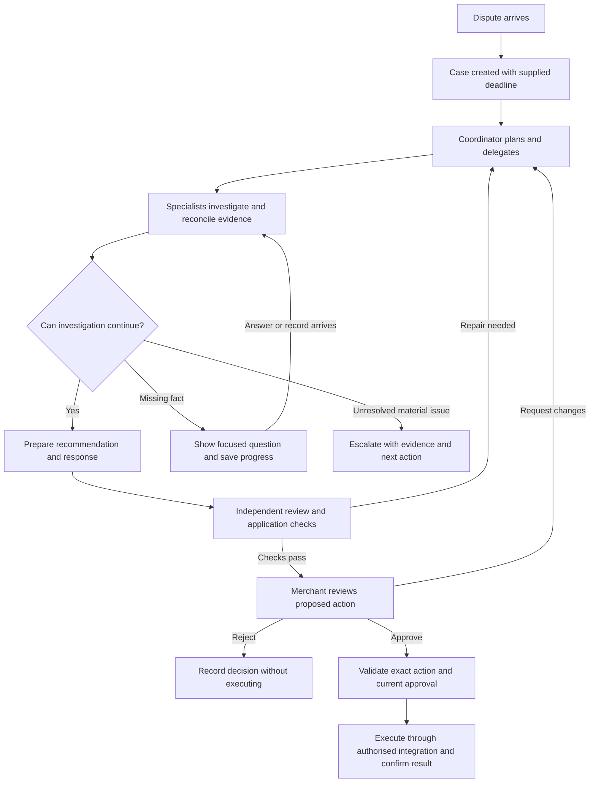

# Product requirements: Dispute Case Preparation Agent

Updated 6 October 2026. This document defines intended behaviour and proposed acceptance targets. It does not certify implementation or measured results.

## Customer and problem

The first customer is a small online retailer selling physical goods, where an owner or small operations team handles chargebacks alongside daily work.

The product addresses three prioritised problems: finding and reconciling relevant evidence, deciding what incomplete or conflicting records support, and preparing a checked response. Two published merchant accounts inform refund reconciliation and changing provider status. Dispute frequency, current effort, demand and willingness to pay remain unvalidated. See [Merchant workflow evidence](merchant-desk-research.md).

The owner or operations lead is the intended user and approver. No permission to submit a case is inferred from receiving a dispute or from an agent recommending a response. The first integration is Stripe; merchant order and fulfilment integrations follow after the evidence and access model is verified.

## Job to be done

When a chargeback arrives, help me determine what happened and prepare an evidence-backed next action before the supplied response deadline, so I can handle the case with less manual work while retaining control over messages, refunds and submissions.

## Proposed customer journey

| Stage | Merchant experience | Agent-team responsibility | Evidence of a useful outcome |
| --- | --- | --- | --- |
| 1. Case arrival | See the complaint, disputed transaction, supplied deadline and current status. | Create the case from an incoming dispute or merchant entry; flag missing details. | Correct transaction association and traceable supplied details. |
| 2. Investigation | See progress and the current plan without directing each tool call. | Delegate evidence and guidance work, search authorised systems and change direction when observations require it. | Relevant records found, cited findings and justified plan changes. |
| 3. Clarification | Receive a focused question explaining why the missing fact matters. | Complete useful independent tasks, persist progress and resume when information arrives. | No repeated requests, retained state and use of the new information. |
| 4. Recommendation | Receive a concise explanation of what the evidence supports and the proposed next action. | Address material claims, explain gaps and conflicts, and prepare a cited draft or alternative resolution. | A sound recommendation, including cases where defending the charge is inappropriate. |
| 5. Quality review | See a case ready for review only after required checks pass. | Independently challenge the draft, repair defects and enforce readiness in code. | Material review issues resolved; unsupported completion blocked. |
| 6. Merchant decision | Approve the exact action, request changes or reject it. | Present the recipient or destination, relevant transaction details, draft version and supporting evidence. | An informed decision tied to the current proposal. |
| 7. Execution and tracking | See whether the approved action succeeded, failed or remains uncertain. | Validate permissions and approval, prevent duplicate effects and confirm the outcome through an authorised integration. | A recorded result; uncertain execution is checked before retrying. |
| Exception: escalation | Receive the unresolved issue, supporting records and a clear next action. | Stop unsupported conclusions and explain why human judgement or intervention is necessary. | Appropriate escalation rather than false readiness. |

## Customer value and product judgement

The intended value is less merchant preparation and review effort while preserving case quality. The product is not successful merely because it produces a draft or completes more cases without questions.

A fixed workflow handles predictable validation, permissions and execution checks. Agents own investigation decisions where the relevant evidence and next action depend on observations. Specialist responsibilities must demonstrate value against a single agent and a fixed checklist.

The product's distinctive value must be demonstrated through reconciliation of scattered records, useful follow-up questions and recovery when facts change. Draft generation alone does not establish an advantage over a provider dashboard, checklist or existing dispute service. Stripe is the first integration choice because its test API and events allow those boundaries to be exercised; this is an engineering choice awaiting customer validation.

## First release priorities

The first release serves small online retailers selling physical goods. Its end-to-end promise is to turn an incoming dispute into a checked recommendation and evidence pack, with saved progress, useful clarification and a clear merchant decision point.

### Included

| Capability | First-release requirement | Reason to include it |
| --- | --- | --- |
| Focused case coverage | Handle non-delivery, conflicting delivery records, duplicate or incorrect charges and missing refunds. Preserve unclear and multi-claim cases. | Covers distinct investigation paths without requiring every merchant business model. |
| Case intake and evidence access | Connect Stripe test-mode dispute intake, verify webhook signatures, retrieve current provider objects and persist evidence deadlines. Read generated imperfect merchant records through validated tools, keeping their provenance separate from Stripe objects. | Tests a genuine API and event boundary alongside repeatable investigation cases. |
| Autonomous investigation | A coordinator assigns specialists, selects tools, reacts to findings and stops within configured limits. | Investigation adapts to what each record shows, and every decision is observable in the trace. |
| Independent review | A review agent identifies specific defects; the coordinator assigns repairs. Code enforces readiness. | Prevents a fluent draft from being treated as a completed case. |
| Persistent work | Save plans, findings, assignments, questions and versions. An event worker resumes cases on new information without duplicate effects. | Makes the product useful beyond a single interaction. |
| Controlled preparation and action | Save drafts automatically, stage Stripe test evidence explicitly without submitting, bind approval to the exact payload and submit once with retry identity. Verify the provider result. | Tests approval at a consequential external API boundary. |
| Published guidance | Retrieve captured, versioned Stripe and public scheme guidance with verifiable citations. Keep summaries supplementary. | Decisions require applicable source passages and freshness evidence. |
| Research-informed imperfect records | Use seeded mismatches, missing and conflicting evidence, late events and hostile messages. Keep private expected answers separate. Use two sourced published merchant accounts as desk research. | Challenges clean-data assumptions without presenting generated records or desk research as interviews. |
| Merchant interface | Show case status, plan, evidence, questions and approve/request-changes/reject controls. | Makes autonomous work understandable and controllable. |
| Integration interoperability | Expose validated case capabilities through a local MCP server and verify a read-only lookup from a second client. | Case capabilities can be reused by other clients rather than tied to one model interface. |
| Quality and operating evidence | Compare fixed-workflow, single-agent and team configurations; record development and held-out results, failures, time, review effort and cost assumptions. | Tests whether autonomy and specialist coordination earn their complexity. |
| Security and recovery | Enforce case and merchant boundaries, reject invalid approvals, test malicious source text and recover from unavailable tools or model failures. | Permissions and recovery are part of the product behaviour. |

### Sequenced after the first release

| Capability | What must be established before adding it |
| --- | --- |
| Production provider access and merchant-system connections | Validate live account permissions, record mappings, tenant isolation and reliable synchronisation after passing Stripe test-mode checks. |
| Production submissions, customer messages and refunds | Establish authenticated merchant approval, authorisation, duplicate prevention and recovery separately for each live external action. |
| Subscriptions, digital products and services | Validate segment-specific needs and evidence requirements, then evaluate representative cases before expanding the coverage claim. |
| Broader provider and market coverage | Source and version applicable guidance and validate differences in case fields, response requirements and deadlines. |
| Larger-scale operations | Establish demand and workload before adding distributed workers, high concurrency and more operational infrastructure. |
| Wider autonomy for consequential actions | Demonstrate reliable outcomes and establish explicit merchant policies, auditability and recovery before removing approval requirements. |

## Priority and trade-offs

- **Complete one customer journey before widening coverage.** Durable investigation, clarification, review and approval provide stronger evidence of product capability than many disconnected features.
- **Keep specialist roles accountable.** Retain separate agents where their responsibilities, context or permissions improve quality or performance. Agent count is not a success criterion.
- **Complete external integration evidence.** Stripe sandbox intake, staging and approved submission are required delivery checks. Production access, actual merchant-system connections and live actions have separate requirements.
- **Prioritise measured outcomes over presentation polish.** The interface must make evidence and control clear; additional visual refinement follows quality and usability findings.

Four prerequisites come before agent development: Stripe integration proof, published-source retrieval, imperfect-record evaluation and sourced merchant desk research.

Payment-system integration and investigation data have different provenance. Stripe supplies simulated payment and dispute objects through its actual API; generated merchant records supply repeatable case evidence. Bind records to provider objects through an explicit mapping, preserving both origins. Arbitrary generated order IDs must not be presented as real provider associations. A separate controlled-outcome submission run tests integration, while agent-quality runs score the evidence and recommendation.

## Behaviour and acceptance criteria

These requirements take priority over adding agents or interface features. Each acceptance check needs a saved result and a trace showing what happened.

| Requirement | Observable behaviour | Acceptance check |
| --- | --- | --- |
| Correct case association | Display merchant, payment, amount, currency, provider status and record origins. Amount calculations use integer minor units. | A mismatched order or duplicate customer profile cannot silently attach evidence to the wrong payment or merchant. |
| Adaptive investigation | Coordinator chooses an authorised next tool, observes its output and updates its plan or stopping decision. Specialists receive bounded assignments and return cited findings. | Traces show different next actions for missing delivery evidence, a conflicting address and a partial refund. A new fact changes the plan. |
| Applicable guidance | Retrieve a relevant passage with source URL, captured version and page or section. Keep provider fields distinct from scheme rules. | Invented citations, changed source hashes and inapplicable passages fail readiness. Unknown effective dates remain unknown. |
| Sound recommendation | Distinguish verified records, reported assertions and unresolved hypotheses. Preparing a defence, requesting information and escalating can each be valid outcomes. | Scoring rejects unsupported delivery claims, fraud allegations or full-refund claims. All material claims are addressed. |
| Decision boundaries | Choose among four decisions on the records available now. **Wait** when a specific, obtainable record would decide the case; absence of a record is not evidence of absence until the authoritative source has been searched. **Accept** when the records show the merchant cannot defend. **Escalate** when a person can resolve what the records cannot, such as an unexplained delivery address or an inbox the agent cannot read. **Respond** only when the records support each material claim. | Labelled cases score each decision type separately against a stated always-respond baseline. Deciding on missing evidence (accepting or defending before an available record is checked) is scored as a failure, not a near miss. |
| Security flag | Suspected prompt injection, impersonation or data-exfiltration attempts in any record raise a separate flag to the merchant, with the record and text quoted. The flag never changes the investigation's permissions or forces escalation on its own. | Both injection channels (customer message, carrier note) raise the flag and leave the case decision driven by the evidence; no tool call follows the injected instruction. |
| Durable clarification | Store the precise question, missing fact, completed work and expected resume event. | After restart, a late answer or record resumes the same case, adds evidence once and changes the recommendation where warranted. |
| Deadline handling | Store Stripe's supplied deadline, display it in the merchant's timezone and compare it in UTC. Surface urgency while a case waits. | Missing or expired deadlines block submission. A deadline reminder flags the case for attention; it never grants approval or invents a defence. |
| Current provider state | A verified event prompts retrieval of the latest provider object. Resolution or changed evidence invalidates an obsolete proposal. | Duplicate and out-of-order events cannot roll a resolved case back or create repeated actions. |
| Complete submission review | Present all material evidence fields, destination dispute, action version and payload hash before approval. | Added provider evidence, a changed proposal, an expired approval or a different dispute ID blocks the original approved action. |
| Explicit staging and submission | Staging uses submit=false; a separate approved action uses submit=true and retains a stable retry identity. | Staging leaves submission count unchanged. A timeout is shown as uncertain until provider state is reconciled; no blind new submission is issued. |
| Recovery | Persist errors, pending actions and an audit trail. Repeated failure pauses the affected task while independent permitted work can continue. | Restart, tool timeout, invalid model output and unavailable records do not produce false success or lose the last saved state. |
| Security boundary | Tool code enforces merchant scope, allowed arguments and action permissions. Retrieved content cannot change those permissions. | Cross-merchant lookup, malicious message instructions, self-approval and attempted live-mode execution are rejected and recorded. |
| Merchant control | Show concise progress, evidence, limitations and approve/change/reject controls. | A reviewer can identify the proposed action and its evidence; rejection produces no submission. Structured decisions are shown rather than hidden model reasoning. |

Stripe staging defaults to submission unless submit=false is explicit, so this distinction belongs in application code. Provider submissions are final opportunities to supply evidence, requiring a complete review before execution. Sources: [Stripe dispute update](https://docs.stripe.com/api/disputes/update), [Responding to disputes](https://docs.stripe.com/disputes/responding).

Webhook arrival is a notification, not an authoritative ordering mechanism. Signature verification, persisted event identity and current-state retrieval are integration requirements. Source: [Stripe webhooks](https://docs.stripe.com/webhooks).

### Bounded autonomy and operating limits

Automatic actions are scoped record reads, guidance retrieval, specialist assignments, local drafts and saved progress. External evidence staging transfers case data to Stripe and therefore requires explicit operator authorisation for the sandbox run. Formal submission requires approval of the complete exact action. Customer messages, refunds and production submissions remain later capabilities.

Proposed initial run limits are 20 model-selected actions across the whole team, 40 tool calls, two review-repair cycles and 15 minutes of active work per attempt. Waiting time is excluded from active runtime but still counts towards deadline risk. These are initial safeguards to test, not latency promises. Stop sooner on completion, a necessary missing fact, material unresolved conflict, expired deadline or permission failure. Exhaustion saves partial findings and escalates; it does not force a draft into readiness.

Set and record the context budget for each loaded model before evaluation. Preserve case identifiers, material evidence, conflicting facts and source references when selecting or summarising context. Record model identifier, prompt and tool versions, context size, elapsed time and available usage for every run. Missing telemetry is reported as unavailable rather than zero.

The current local operator can approve through the command line. That tests action binding; it does not establish authenticated merchant approval for production. Production release requires identity, role enforcement and isolation beyond the local operator flow.

## Success measures and evaluation decision

The primary outcome is **correctly prepared cases with less total human effort**. A correct case has the expected terminal preparation state, a supported recommendation, the necessary evidence or clearly justified gaps, valid citations and the appropriate approval boundary. Waiting or escalation counts as success when required by the case's evidence. A bank win is not the preparation success metric.

Precise definitions, the metric tree and counter-metrics are in [Metrics](metrics.md). These are proposed targets to freeze before agent evaluation. Changes need a dated rationale, with results under the previous target retained.

| Measure | Definition | Proposed target and interpretation |
| --- | --- | --- |
| Case task success | Cases passing the full rubric / all attempted cases; failures and timeouts stay in the denominator. | Development at least 11 of 12 with every wait, accept and escalate case correct; held out at least 5 of 6; see [frozen targets](metrics.md#targets-frozen-6-october-2026-before-any-agent-run). |
| False readiness | Cases marked ready despite a material unsupported fact, unresolved conflict or invalid citation / cases marked ready. | Zero observed in the release suite. If no case is ready, report not applicable, not 0%. |
| Evidence recall | Required relevant evidence found / independently labelled required evidence; justify alternative adequate evidence. | At least 90%. Inspect misses that change the recommendation, not just the aggregate. |
| Appropriate waiting or escalation | Correct waits/escalations and missed necessary interventions, scored separately. | No missed intervention that permits an unsupported submission; report unnecessary escalations as friction. |
| Grounding | Material factual and guidance claims supported by the cited applicable records / all material claims. | 100% on cases presented ready for review; publish counts and reviewer disagreements. |
| Permissions and duplicate effects | Successful unauthorised actions and duplicate submissions in deliberately challenged runs. | Zero observed; disclose attempted attacks, failures and suite size. |
| Human effort | Preparation plus review plus correction minutes for the same case and outcome quality. | At least 30% median reduction against a timed checklist baseline; simulated operator timing remains distinct from merchant timing. |
| Operational burden | Active runtime, elapsed time including waits, tool calls, repairs and failure rate. | Report median and p90 with sample size. No run exceeds its configured budget without a recorded stop. |
| Outcome economics | All attempted-run compute, infrastructure, tool and review costs / correctly completed cases. | Lower total cost per successful case than the checklist baseline at comparable quality. If none succeed, report undefined. |

Evaluation starts with 12 development cases and six held-out cases. Blind labels, acceptable alternatives and prohibited actions are recorded before agent outputs are inspected. Resolve disagreements under written rules; retain original-label results. The 80 complaint-only triage cases are a prior component baseline, not evidence of record-investigation quality.

Compare a fixed checklist, one agent and the specialist team on the same inputs, permissions, model configuration, outcome rubric and frozen source versions. Where possible, counterbalance the order of human timing to limit familiarity effects. Account for every specialist's calls and elapsed time. Keep negative experiments and diagnose failures through the trace.

Six held-out cases are a diagnostic check, not a reliable estimate of production performance. Report counts rather than implying precise percentage confidence. The release decision considers each material failure and the security suite separately from the overall score. Coverage claims require labelled cases for each advertised case type; the seeded generator does not yet establish coverage of every duplicate-charge or incorrect-amount path.

Local inference may avoid an API charge, but has compute and review costs. Estimate power, hardware and reviewer time with explicit assumptions; keep measured usage separate from estimates. Scenario dispute amounts are not an estimate of revenue protected, and controlled test outcomes are not merchant win-rate evidence. Stripe explains that sandboxes simulate objects without moving funds through banks or card networks: [Testing environments](https://docs.stripe.com/testing-use-cases).

## Release decision and adoption

The first release decision concerns a working sandbox-connected system. Passing it requires the four-part evidence checkpoint, the acceptance checks above, recorded evaluation results and no unresolved material permission or false-readiness failure. A failure blocks the affected capability until repaired and re-evaluated. It must not disappear into an average score.

Retain the team architecture if it produces a defensible improvement over the simpler alternatives. If it adds cost and latency without better quality or lower human effort, simplify the orchestration and preserve the comparison as a product decision.

The intended adoption path is connecting payment and order records, reviewing the first prepared case and expanding use only after merchants can understand and trust the evidence and controls. Baseline assumptions about case frequency, onboarding effort, data availability, repeat usage and willingness to pay remain open. Public desk research cannot validate these. Production demand and readiness remain separate from the sandbox release decision.

After any later production release, material false readiness, wrong-merchant evidence or unauthorised execution triggers suspension of external writes, preservation of affected traces and human reconciliation. Re-enable the affected capability only after the failure is understood and regression checks pass.

### Decision to revisit scope

Change priorities if merchant research identifies a different dominant pain point, evidence cannot be accessed reliably, the team fails to outperform a simpler approach, or review effort removes the intended time savings. A technically completed feature does not by itself justify release.

## Research and measurement dependencies

Published merchant accounts support specific workflow concerns, while the overall journey remains proposed. Dispute frequency, preparation and review effort, record access, alternatives and adoption controls require further customer validation before demand claims are made. Direct merchant interviews have not yet been conducted.

Assess preparation time, review time, evidence coverage, recommendation quality, appropriate escalation and cost per successful case. Keep provider decision time and dispute outcomes separate from the parts of the process the product directly controls.

## Related product decisions

- [Product brief](product-brief.md): agent roles, case states, autonomy policy and readiness checklist.
- [Product strategy](product-strategy.md): initial segment and expansion rationale.
- [Current workflow](current-workflow.md): working view of today's process and research unknowns.
- [Pain-point priorities](pain-point-priorities.md): priority rationale and evidence needed.
- [Customer research](customer-research.md): questions about recent merchant behaviour.
- [Merchant workflow evidence](merchant-desk-research.md): published accounts, source limitations and product changes.
- [Evidence checkpoint](real-world-evidence.md): the four required evidence foundations and their current status.
