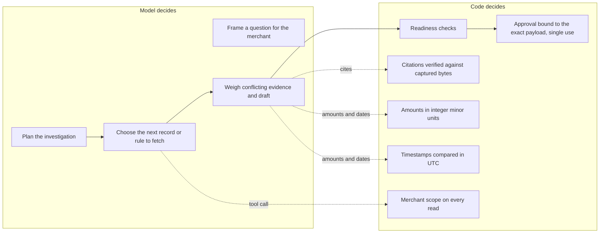

# Where the agent decides and where code decides

The product gives a model agency only where the path through a case cannot be known in advance. Everything that has a single correct answer, or whose failure would be costly and irreversible, is code. This boundary is the main reliability decision in the architecture.

## Why investigation needs agency

A fixed checklist breaks on the cases that matter, because the next useful step depends on what the last record showed. Every case below starts as "I did not receive my order", and every one needs a different next move:

| What the records show | Right next move | Why a fixed sequence fails |
|---|---|---|
| Tracking in transit, no delivery scan | Request the carrier record and wait | Defending or accepting now is wrong in one of the two possible carrier outcomes |
| Delivered to an address that is not on the order | Search for an address-change request; escalate if none exists | The same delivery scan supports the merchant in one case and not the other, depending on a single email |
| Payment and order IDs differ by a leading zero | Look for an authoritative link such as a checkout session | Treating the IDs as a match risks submitting another customer's evidence |
| Two customer profiles share an email | Identify the payer by payment and order IDs, not email | Merging profiles on email attaches the wrong customer's history |
| The customer says the dispute was withdrawn | Re-read the provider's current status | The statement is an assertion; the provider state decides |

Each new fact changes the plan: which record to fetch, whether to wait, whether the case is ready. Choosing among those options, framing a focused question for the merchant and weighing conflicting records is judgement that a fixed workflow cannot encode without enumerating every case in advance.

In blind labelling, the most common human error was the same in four cases: deciding on missing evidence instead of fetching it. The agent's value is doing the investigation step reliably, not writing a longer response.

## Why calculations, permissions and final checks are code

| Concern | Decided by | Reason | Evidence from the build |
|---|---|---|---|
| Amounts owed and refunded | Code, integer pence | One correct answer; a model error pays the merchant's money twice | A £900 dispute with £500 already refunded: accepting it would refund £500 twice |
| Time order of events | Code, parsed and compared in UTC | Text comparison of local times gives the wrong answer | 05:45 New York time is before a 10:00 UTC payment; 11:45 London time is after it |
| Which merchant's data can be read | Code, at the tool boundary | Must hold even if the model is manipulated | Cross-merchant reads and path-style IDs are rejected |
| Whether a citation is real and current | Code, against captured source bytes | A plausible citation is not a verified one | Invented, altered and stale citations are rejected (7 of 7 checks) |
| Whether a case is ready for review | Code checks structure; reviewer agent checks substance | Readiness must not depend on the model's confidence | Missing sources or unresolved conflicts block readiness |
| Whether evidence is submitted | Code plus a named human approving the exact payload hash | Submission is final and cannot be edited | Wrong hash rejected; second submission refused; result confirmed from Stripe's counter |
| What to do with instructions found in records | Code: records are data, no tool can export, email or self-approve | Prompt injection will sometimes fool a model; it must have nothing to call | Attack text arrives labelled untrusted through both channels tested |

## The rule

Give the model the choices whose correct answer depends on context. Keep in code anything that has one right answer, anything a manipulated model must not be able to change, and anything that moves money or cannot be undone. The model may propose; code verifies and a person approves.

## What this means for evaluation

Code-owned checks are tested deterministically and must pass every time. Model-owned behaviour is tested against the frozen case set and scored per decision type, against trivial baselines: always responding matches 8 of 18 decisions on the records available at the start, and 12 of 18 final recommendations. A fixed checklist and a single agent are evaluated on the same cases before any specialist agent is added.
