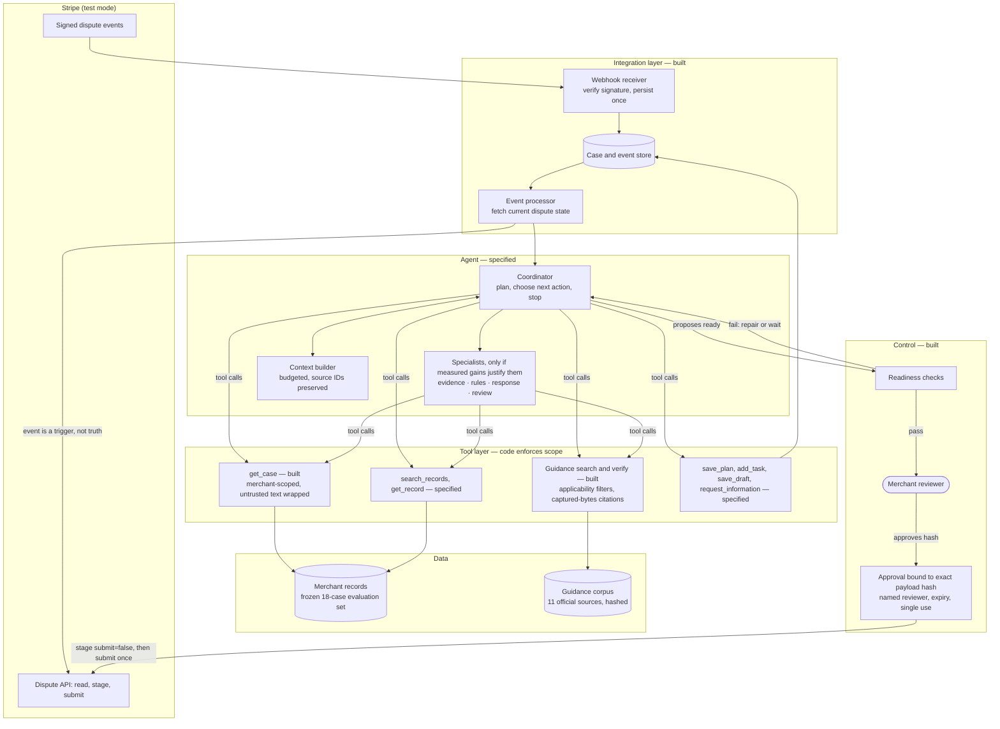
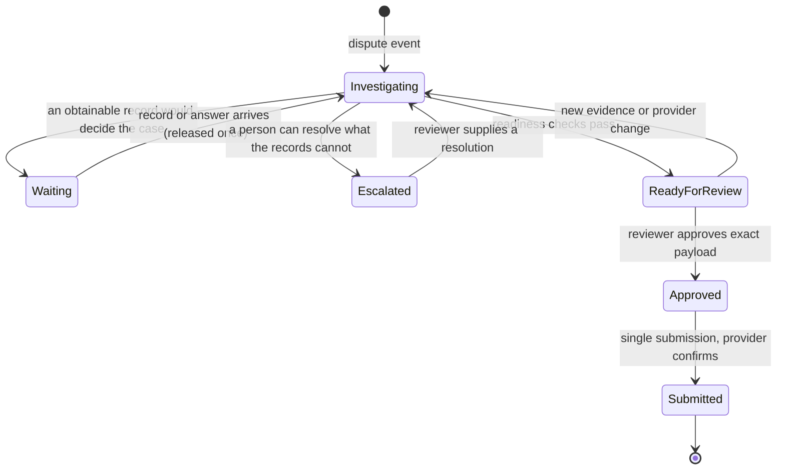

# Architecture

How a dispute moves from a provider event to a reviewed, approved action, and which component owns each decision. Components marked **built** exist and are tested; **specified** components are designed with acceptance checks but not yet implemented.

## System overview

## What each arrow guarantees

| From → to | Guarantee | Status |
|---|---|---|
| Stripe events → receiver | Signature verified; each event stored once by ID; acknowledged even when a duplicate | Built |
| Processor → Stripe API | Current dispute state is fetched for every event, so order and duplicates cannot roll a case back | Built |
| Coordinator → tools | Every call carries the merchant and case; tools reject other merchants, malformed IDs and arguments outside their schema | Built for `get_case`; specified for the rest |
| Tools → merchant records | Customer, carrier and complaint text arrives labelled as external content, never as instructions | Built |
| Guidance → coordinator | Passages are filtered by network, source type and reason code before ranking; every citation is checked against the captured bytes | Built |
| Coordinator → readiness | The model may propose "ready"; code checks sources, claims, conflicts and required fields | Specified |
| Reviewer → approval | Approval names a person and the exact payload hash, expires and is consumed on use | Built |
| Approval → Stripe | Evidence is staged with `submit=false`; submission is a separate approved call with a stable idempotency key, confirmed by reading the provider afterwards | Built |

## Case lifecycle

## Design principles

- **Judgement where context changes the answer; code everywhere else.** See [agency boundary](agency-boundary.md).
- **Provider state over event content.** Events wake the system; the provider's current object decides.
- **Least privilege over clever prompting.** No tool can export data, message customers, refund or approve. An injected instruction has nothing to call.
- **Complexity earns its place.** A fixed checklist and a single agent are evaluated on the frozen case set before any specialist is added; a specialist stays only if it improves correctness or effort enough to cover its cost and latency.
- **Everything versioned.** API version pinned, guidance content-hashed, dataset frozen, results stamped with corpus and dataset versions.
