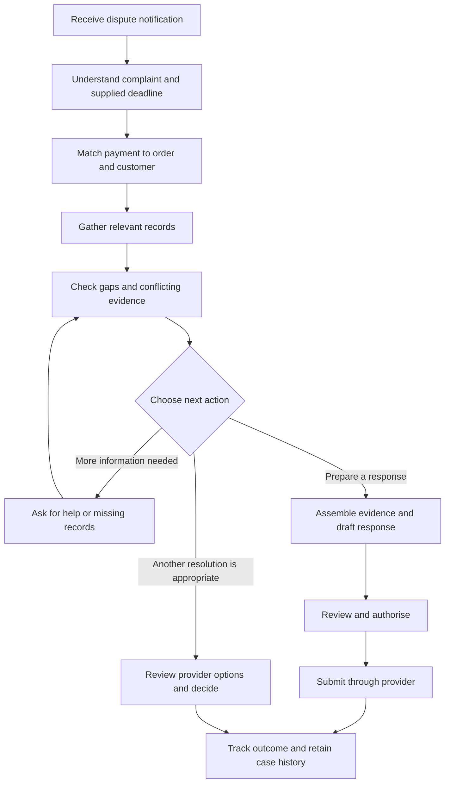

# Current merchant chargeback workflow

## Working view

This is a working map for small online retailers selling physical goods. It describes a workflow to validate through merchant research, rather than a process confirmed by interviews. Provider-specific steps and deadlines come from the merchant's payment provider.

## Steps, effort and unknowns

| Step | Merchant work | Information or systems involved | What needs validating |
| --- | --- | --- | --- |
| 1. Receive notification | Notice the case and identify who will handle it. | Payment-provider notification and dispute dashboard. | How cases arrive, how often they occur, who owns them and whether notifications are missed. |
| 2. Understand the complaint | Read the claim, transaction details, provider instructions and supplied deadline. | Dispute details and applicable provider guidance. | Whether the claim is clear, which guidance is available and how deadlines are tracked. |
| 3. Find the transaction | Match the disputed payment to the order and customer. | Payment and order records. | Whether matching is automatic, which identifiers connect systems and how mismatches are handled. |
| 4. Gather relevant evidence | Find the records that address the specific claim. | Order details, delivery records, customer messages, agreed policies and refund history. | Which records are accessible, how much searching is manual and which evidence is routinely missing. |
| 5. Reconcile the facts | Establish what the records support and identify gaps or contradictions. | The assembled records and their source references. | How merchants resolve disagreements, distinguish assertions from verified facts and decide when help is needed. |
| 6. Choose a response | Decide whether to prepare a response, seek more information or pursue another resolution through available provider options. | Case facts, provider guidance and merchant judgement. | Who decides, what influences the decision and when defending a charge is inappropriate. |
| 7. Prepare the case | Select evidence and write a concise explanation addressing the complaint. | Supporting records and the provider's response requirements. | Time spent writing, repeated work, format constraints and reliance on templates or paid services. |
| 8. Review and authorise | Check accuracy, omissions, recipient or destination and the proposed action. | Final response, evidence pack and responsible merchant user. | Whether a second person reviews, which actions require approval and how approval is recorded. |
| 9. Submit or carry out the decision | Perform the authorised action through the appropriate provider process and confirm its result. | Provider interface or authorised integration. | Available actions, submission confirmation, failure recovery and duplicate-action prevention. |
| 10. Track and learn | Record the outcome and retain relevant case history. | Provider updates and merchant case records. | Outcome visibility, retention practices and whether lessons change future handling. |

## Potential friction to investigate

- Moving between systems to locate records and match a payment to an order.
- Deciding which evidence matters when complaints are ambiguous or records conflict.
- Repeatedly assembling and reviewing information under a deadline.

These are hypotheses. Their frequency, severity and time cost have not yet been measured. The next prioritisation decision should distinguish inconvenience from problems that materially affect merchant effort or case quality.

## Product implications

Matching identifiers, checking permissions and confirming submission are candidates for deterministic code. Investigation can benefit from agency when new evidence changes the next useful action. Merchant review remains a distinct decision point before consequential external actions.

Case preparation time and review time should be measured separately from provider decision time. A chargeback outcome alone does not establish whether the preparation product worked well.
