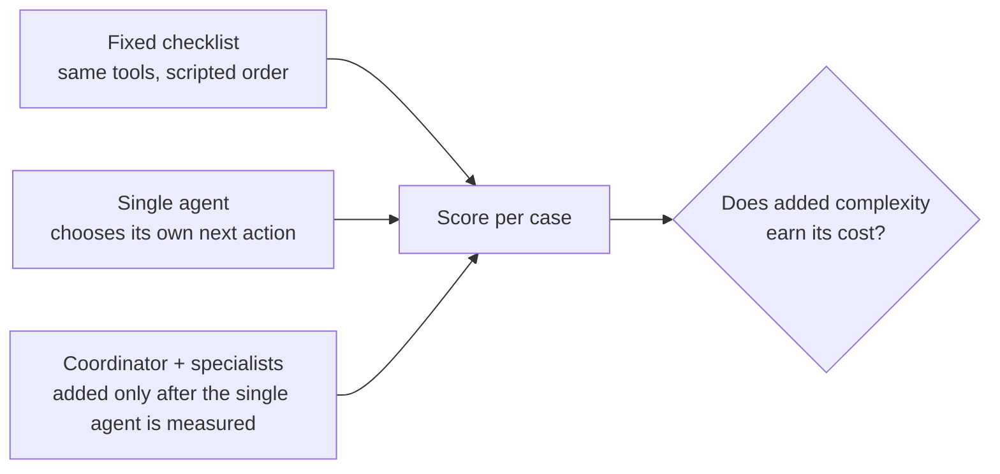

# Evaluation strategy

How the agent is judged, which comparisons decide the architecture, and what protects the results from being fooled. Scoring rules are in the [rubric](evaluation-rubric.md), metrics and frozen targets in [metrics](metrics.md), failure classes in the [taxonomy](failure-taxonomy.md).

## Datasets

| Set | Contents | Use |
|---|---|---|
| Development | 12 generated cases (6 contrast pairs), frozen at fingerprint `6cdaadd3fd1d` | All diagnosis and iteration |
| Held out | 6 cases (3 contrast pairs) | Run once, after the configuration is frozen |
| Retrieval questions | 10 reviewed questions over the captured guidance corpus | Retrieval changes, scored against the saved baseline |
| Stripe test disputes | Live test-mode objects | Integration behaviour only; outcomes are controlled and never count as quality |

Pairs never cross sets. Generator answers were checked against blind human labels (5 of 7 independent agreement) and disagreements resolved under written rules. Held-out answers are known to the developer, so no decision is tuned on them.

## Retrieval scoring

- **Guidance:** right passage in the top five and mean reciprocal rank on the reviewed questions, with applicability filters on and off. Baseline: 4 of 10, MRR 0.28 (filtered).
- **Merchant records:** each case's required source IDs are the relevant records. Record recall = required records the agent fetched ÷ required records, scored from the trace. A decision made without fetching the decisive record also fails case success.

## The architecture comparison

Three configurations run on the same development cases with the same tools, permissions, model, guidance corpus, budgets and scorer:

| Configuration | What it isolates |
|---|---|
| Fixed checklist | Value of the tools and data alone, without judgement |
| Single agent | Value of adaptive investigation |
| Coordinator with specialists | Value of separate roles, instructions and permissions |

**Decision rule:** a configuration replaces the simpler one only if it improves correctly prepared cases or human effort by at least one development case, with no new zero-tolerance failure, at a cost and runtime the merchant would accept. Otherwise the simpler configuration ships and the result is reported as a finding.

## Run protocol

1. Freeze the configuration: model, prompt, tool versions, corpus version, budget.
2. Run every development case; save every trace, including failures and budget stops.
3. Score with code; reviewers score judgement checks without seeing the configuration name.
4. Classify every failure before changing anything; one change per iteration; re-run all development cases.
5. When development targets are met, freeze and run the held-out set once. Report it separately, in counts.

## Integrity rules

- Results name the dataset fingerprint, corpus version, model, prompt and tool versions.
- Results are never compared across dataset or corpus versions.
- Event experiments run on a copy; the frozen files are never modified.
- Label or target changes are dated, reviewed and reported beside the original results.
