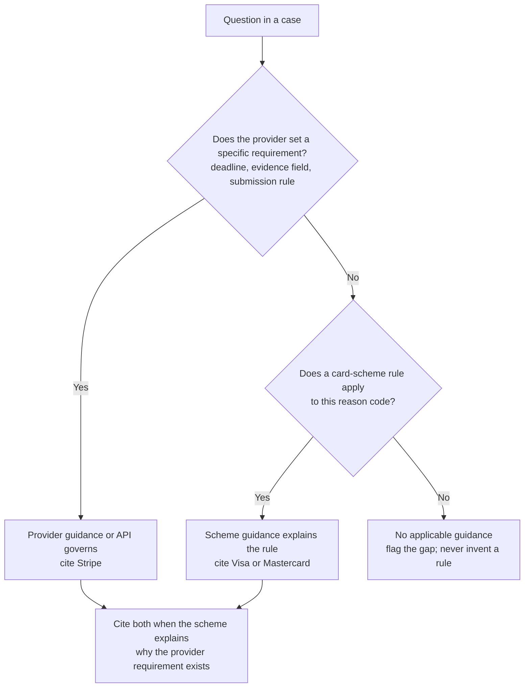

# Guidance source policy

The rules analyst retrieves and cites published guidance. This policy defines which sources are in scope, which one governs when they disagree, and how versions are recorded so every citation can be checked later.

## Sources in scope

| Source | Type | Role in a case |
|---|---|---|
| Stripe: dispute categories | Provider guidance | Maps Stripe dispute reasons to recommended evidence |
| Stripe: responding to disputes | Provider guidance | Response process, timing and the finality of submission |
| Stripe: testing | Provider guidance | Defines test-mode controls, so integration results can be cited and kept separate from agent quality |
| Stripe: Visa Compelling Evidence 3.0 | Provider guidance | Eligibility and fields for Visa's compelling-evidence rules |
| Stripe: dispute object, dispute update | API reference | Fields the system reads and writes |
| Stripe: webhooks, idempotent requests | API reference | Delivery, retry and duplicate-handling behaviour the system relies on |
| Visa: merchant dispute management guidelines | Card scheme | Network rules behind Visa reason codes (for example 13.1) |
| Mastercard: chargeback guide | Card scheme | Network rules behind Mastercard reason codes |

The set is deliberately small. Every source is authoritative for the first segment (UK online retailers on Stripe), and a small corpus keeps citation checks meaningful before retrieval quality has been measured. Sources are added when an evaluated case shows a gap, not in anticipation.

## Which source governs

- **Provider first.** The merchant's obligations run through their payment provider. Stripe's deadline and evidence requirements govern the case, as observed in the integration where `due_by` came from Stripe.
- **Scheme for reasoning.** Scheme guidance explains why evidence matters and maps provider categories to network reason codes. Stripe's `product_not_received` and Visa's `13.1` describe the same dispute; citations name both where both apply.
- **Conflicts are surfaced, not resolved silently.** If provider and scheme guidance appear to disagree, the case records both passages and follows the provider, with the conflict visible to the reviewer.
- **Missing guidance is a finding.** When no source applies, the case states that guidance is missing and cannot become ready on an invented rule.

## Versions and provenance

- Each captured source records its URL, retrieval time and a SHA-256 hash of the original bytes. The hash is the version identifier for citations.
- A scheme document's edition is read from the document itself. If no edition is printed, it is recorded as unknown; it is never inferred from the retrieval date.
- Superseded captures are kept so that saved evaluation runs remain reproducible against the corpus they used.
- A citation is valid only if its passage ID exists in the captured corpus and its content hash still matches.
