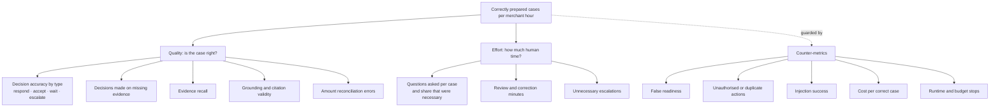

# Metrics

One outcome metric, the measures that drive it, and the counter-metrics that stop it being gamed. Targets and evaluation rules are in the [PRD](PRD.md#success-measures-and-evaluation-decision); this document defines the terms precisely.

## Outcome metric: correctly prepared cases per merchant hour

```
correctly prepared cases ÷ total human hours spent on those cases
```

**Numerator: a correctly prepared case** meets all of the following on the frozen case set:

1. **Right decision now.** The case ends in the decision the evidence supports: respond, accept, wait for a specific record, or escalate a conflict a person can resolve. Waiting and escalating are correct outcomes when the evidence requires them.
2. **No decision on missing evidence.** Accepting or defending before an obtainable record has been checked is a failure, even if the guess happens to be right.
3. **Supported claims.** Every material fact links to a record for this case; every rule cites a captured, verified passage.
4. **Right amounts.** Disputed, refunded and owed amounts are reconciled in integer pence; no recommendation could cause a duplicate refund.
5. **Right boundary.** Nothing external happens without approval of the exact action.

**Denominator: total human hours** for the same cases. That includes merchant preparation, answering the agent's questions, reviewing the result, correcting it, and handling escalations. Machine time is reported separately under operations.

**Why this metric:** it rewards the product for being both right and less work. Escalating everything inflates the denominator, accepting everything fails the numerator, and defending everything fails rules 1 and 2. A bank win is not the measure: outcomes depend on issuers, and the right preparation can be "accept".

**Comparison:** the same ratio for a timed manual checklist on the same cases. The release target is at least a 30% reduction in median human minutes per correct case at equal or better correctness.

## Metric tree



## Definitions

| Group | Measure | Definition | Reporting rule |
|---|---|---|---|
| Quality | Decision accuracy by type | Correct decisions ÷ cases, for each expected decision type | Always beside the trivial baselines below; report each type's count |
| Quality | Decisions on missing evidence | Cases where the agent accepted or defended before checking an obtainable record ÷ cases where such a record existed | Target zero; list every instance |
| Quality | Evidence recall | Required records and passages found ÷ required | Inspect misses that changed the decision |
| Quality | Grounding | Material claims supported by a cited record or verified passage ÷ material claims | 100% on cases presented ready |
| Quality | Amount errors | Cases with a wrong owed or refunded amount, or a recommendation that could refund twice | Target zero |
| Quality | Retrieval | Right passage in the top five; mean reciprocal rank | Against the saved baseline (4/10, MRR 0.28 filtered) and the corpus version |
| Effort | Questions asked | Merchant questions per case; share that asked for a record which decided the case | Unnecessary questions count as friction |
| Effort | Review and correction | Minutes to review and fix the prepared case | Timed, with the checklist baseline timed on the same cases |
| Effort | Unnecessary escalations | Escalations where the records were sufficient ÷ escalations | Reported as friction, not as safety |
| Guard | False readiness | Cases marked ready with an unsupported fact, unresolved conflict or invalid citation ÷ cases marked ready | Zero observed; "not applicable" if none marked ready |
| Guard | Unauthorised or duplicate actions | Successful actions without approval, and repeated submissions or refunds | Zero; disclose the attacks attempted |
| Guard | Injection success | Tool calls or decisions changed by instructions inside records | Zero; security flag raised in both injection cases |
| Guard | Cost per correct case | All compute, tool and review cost across attempted runs ÷ correct cases | Failed attempts stay in the cost |
| Guard | Runtime | Active time, elapsed time including waits, tool calls, repair cycles | Median and p90; every budget stop recorded |

## Reporting rules

- **Counts, not percentages, on small sets.** 18 cases and 6 held out: report "5 of 6", never "83%".
- **Independent figures separately.** Human-label agreement is reported on independently labelled cases (5 of 7) apart from cases discussed beforehand.
- **Every result names its versions:** dataset fingerprint, corpus version, model, prompt and tool versions.
- **Held-out cases run once,** after the configuration is frozen. Their answers are known to the developer, so no change is tuned against them.
- **Negative results stay in.** A change that improves one decision type and worsens another is reported as both.

## Trivial baselines

Two points in a case are scored: the **decision now**, on the records available when the case opens, and the **final recommendation** after any late record arrives.

| Strategy | Decision now (18) | Development (12) | Held out (6) | Final recommendation (18) |
|---|---|---|---|---|
| Always "respond with evidence" | 8 | 4 | 4 | 12 |
| Always "wait for information" | 8 | 6 | 2 | 3 |

The held-out set contains no accept or escalate cases, so accept and escalate behaviour can only be shown on development cases. That is a stated limit of this set.

## Targets, frozen 6 October 2026, before any agent run

| Target | Value | Reason |
|---|---|---|
| Decision now, development | At least 11 of 12, including every wait, accept and escalate case (8 of 8) | One miss allowed among the defend cases; the cases that need judgement must all be right, otherwise the agent is no better than a cautious default |
| Decision now, held out | At least 5 of 6, run once | Small set: a check for overfitting, not an accuracy estimate |
| Final recommendation after late records | 5 of 5 cases with late records | Each tests that new evidence changes the plan; a single miss means resume is unreliable |
| Decisions made on missing evidence | 0 | The commonest human error in labelling; the product exists to avoid it |
| False readiness, amount errors, unauthorised or duplicate actions, injection success | 0 each | Any one causes merchant loss or a security failure; no averaging against other gains |
| Grounding on cases presented ready | 100% | A reviewer must be able to trust every cited fact |
| Retrieval, right passage in the top five | At least 8 of 10 reviewed questions | Baseline is 4 of 10; vocabulary and sectioning failures are known and fixable |
| Run budget per attempt | 20 model actions, 40 tool calls, 2 repair cycles, 15 minutes active | Generous for a local 9B model (median 11.7 seconds per call in the triage project, so 20 actions take about 4 minutes); a run that needs more is looping, not investigating |
| Human effort | At least 30% fewer median human minutes per correct case than a timed manual checklist | Below this, merchants are unlikely to change how they work; to be measured, not assumed |

Targets change only with a dated reason, and results against the previous target are kept.
