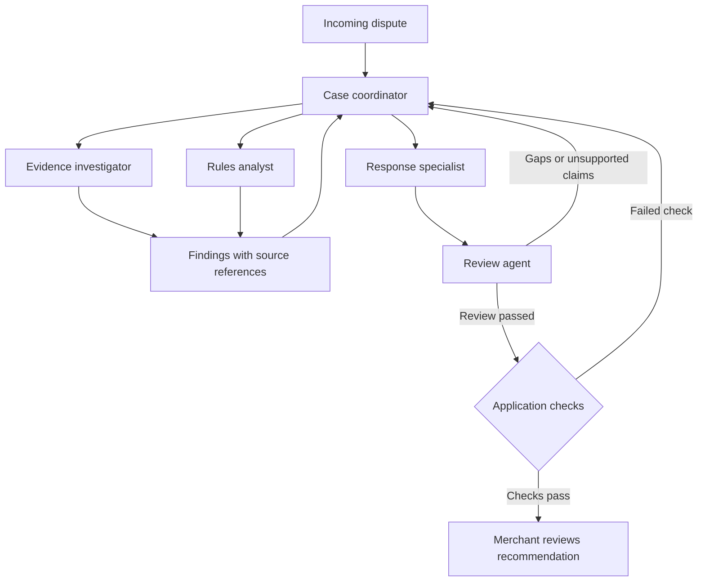
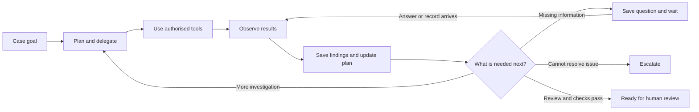
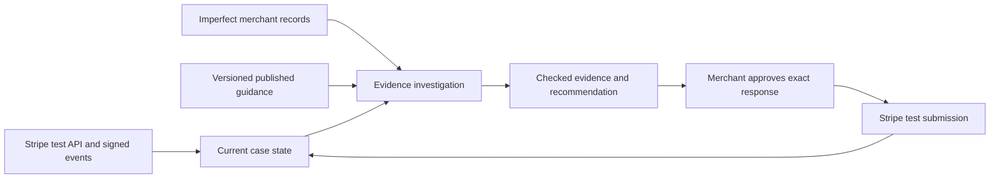
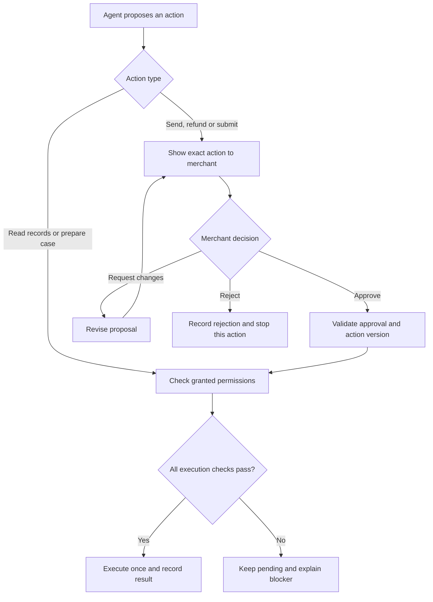

# Product brief: Dispute Case Preparation Agent

## Customer and problem

Small merchants selling physical goods, digital products, services and subscriptions need to handle chargebacks while running their businesses. Information is scattered across payments, orders, customer messages, delivery systems and refund histories. Preparing a case means deciding what matters, finding evidence, resolving gaps and choosing a response.

## Product goal

Give merchants an autonomous team of agents that takes ownership of case preparation from an incoming dispute to a checked, evidence-backed recommendation. The team investigates independently and involves the merchant when a decision, permission or unavailable fact requires them.

## Customer experience

1. A dispute arrives through a connected payment provider or is added by the merchant.
2. The team creates a case and plans an investigation around the complaint and supplied deadline.
3. Specialist agents search merchant systems, assess relevant guidance and assemble evidence. Independent tasks can run in parallel.
4. The team changes its plan as it learns. A cancellation confirmation, conflicting delivery record or completed refund can change who acts next and what outcome it recommends.
5. If a material fact is unavailable, the team asks a focused question, saves progress and waits. It resumes automatically when an answer or relevant record arrives.
6. A separate review agent challenges the proposed response. The team repairs identified gaps or escalates an unresolved issue.
7. The merchant receives a concise recommendation, supporting evidence and a response ready for approval. They can inspect findings and changes in direction.

## Agent team

The coordinator owns the case. Specialists return findings, and review failures create further work before the merchant sees a recommendation ready for approval.

| Agent | Responsibility | Decisions it owns |
| --- | --- | --- |
| Case coordinator | Own the plan, delegate work and track progress against the supplied deadline. | Which specialists to involve, which tasks can run in parallel and when to replan, wait or escalate. |
| Evidence investigator | Find and reconcile transaction, order, fulfilment, access, message, cancellation and refund records. | Which authorised system to search next, which evidence matters and which gaps need further investigation. |
| Rules analyst | Identify applicable guidance using the provider, reason code and case facts. | Which sourced guidance applies, which claims need investigation and when guidance is missing or unclear. |
| Response specialist | Assemble a cited summary and draft the proposed response or alternative resolution. | Which facts support the recommendation and whether the evidence supports defending the charge. |
| Review agent | Independently challenge findings, citations, evidence coverage and the proposed action. | Which issues require repair and whether to recommend escalation or human review. |

Agents have separate instructions, structured assignments and tool permissions. They exchange findings through a shared case record with source IDs. Specialist reports are inputs to check, rather than facts to accept automatically. The coordinator can reassign work when a report exposes a new problem.

## Autonomous behaviour

Each observation can change the next action. Saved state lets the team continue the same case after waiting or restarting.

- **Own the work:** pursue the case goal without requiring the merchant to prompt each step.
- **Choose actions:** select tools and delegate tasks based on current evidence, rather than follow the same sequence for every complaint.
- **Adapt:** revise the plan when new facts contradict an assumption or make a task unnecessary.
- **Act within permissions:** read authorised systems and save plans, evidence links, internal tasks and drafts automatically.
- **Remember and resume:** persist findings, completed actions, open questions and assignments across restarts and waiting periods.
- **Respond to events:** use a case worker to resume on new disputes, records, answers and deadline reminders. Process persisted events without duplicating actions.
- **Check and repair:** use review findings to trigger targeted additional work before requesting approval.
- **Stop deliberately:** finish when application checks pass, wait when information is needed or escalate when the team cannot resolve a material issue. Apply configurable limits on calls, time, retries and cost.

## Chargeback coverage

Support unrecognised or allegedly unauthorised payments, goods not received, digital products or services not provided, quality or description complaints, charges after cancellation, missing refunds, duplicate charges and incorrect amounts. A case may contain multiple claims or an unclear category.

Evidence requests should reflect the business and complaint. A service appointment, physical delivery and digital purchase need different investigations.

## Inputs

- Dispute details: complaint, transaction, amount, provider, supplied reason code and response deadline.
- Records from authorised merchant systems: payments, orders, fulfilment, service delivery, digital access, customer messages, agreed policies, cancellations and refunds.
- Applicable reference rules and provider instructions, with their source and version.
- Earlier triage results, when available, as a starting hypothesis to verify.
- Merchant answers, newly available records and approval decisions.

Missing inputs remain visible. The team must not invent a fact, rule or deadline.

### Evidence foundation

Stripe test-mode disputes provide the integration's payment objects, signed events and supplied deadlines. Payment-provider objects stay distinct from generated order, delivery, refund and message records. Published Stripe and scheme guidance is captured with source links, retrieval dates and content versions. Two published merchant accounts inform refund reconciliation and late status-change scenarios through desk research; they are not interviews conducted by this project.

The integration must demonstrate actual API execution and observed state changes. Controlled Stripe test outcomes test the submission lifecycle; they do not measure agent quality or real merchant win rates. Source capture, retrieval and dataset checks must also produce recorded evidence before the build progresses past the evidence checkpoint. See [Evidence requirements](real-world-evidence.md) and [Merchant workflow evidence](merchant-desk-research.md).

## Outputs

- A plain-language case summary explaining the complaint, findings and recommended next action.
- An evidence pack linking each important finding to its supporting record or guidance.
- A proposed response or alternative resolution, with the reason it fits the evidence.
- Outstanding questions, conflicts and tasks, with a clear owner and next action.
- A visible case status: investigating, waiting for information, ready for review or escalated.
- An activity record showing assignments, tool actions, findings, plan changes and review outcomes.

## Case states

| State | What it means | Example | What happens next |
| --- | --- | --- | --- |
| Investigating | The coordinator and specialists are actively gathering, checking or repairing the case. | A customer says an order never arrived. The evidence investigator checks delivery records while the rules analyst checks the supplied provider guidance. | The coordinator uses their findings to choose the next tasks or move the case to another state. |
| Waiting for information | A material fact is unavailable and the team cannot complete the case without it. Progress and the specific question are saved. | A customer says a promised refund never arrived. The payment record is unavailable, so the team asks the merchant for the refund reference. | A relevant answer or record triggers a return to investigating. The team checks the new information before using it. |
| Ready for review | The review agent's findings have been addressed and application checks pass. The recommendation and evidence are awaiting a human decision. | An alleged duplicate payment has been investigated. The case summary cites the payment records, explains the finding and includes a proposed response for approval. | The merchant approves, rejects or requests changes. Requested changes return the case to investigating. Readiness itself does not authorise an external action. |
| Escalated | The team needs human judgement or intervention to resolve a material issue it cannot handle within its permissions or limits. | Two delivery records show different addresses and further investigation cannot establish which is correct. | A reviewer receives the conflict, supporting sources and reason for escalation. The case returns to investigating only when a reviewer supplies a resolution or authorises a defined next step. |

The coordinator proposes state changes; application checks validate and record them. Every change records its reason, relevant source IDs and any outstanding question or task. Individual agents completing assignments does not mean the whole case is ready.

The team continues independent tasks before waiting, where those tasks can still help. Exhausted retries, time or call limits must lead to a recorded pause or escalation, rather than a claim that the case is complete. New evidence received while a case is ready for review returns it to investigation and invalidates approval of any superseded draft.

## Permissions and completion

### Autonomy policy

Investigation proceeds within granted permissions. External actions pass through explicit approval and application checks before execution.

The team owns investigation and preparation without needing the merchant to approve each tool call. Its permissions apply to the specific merchant, case and connected systems.

| Action | Can the team act automatically? | Control |
| --- | --- | --- |
| Read authorised records and applicable guidance | Yes | Enforce merchant and case access at the tool boundary. |
| Delegate investigations, compare findings and revise the plan | Yes | Keep assignments and findings in the case activity record. |
| Save evidence links, internal tasks, plans and response drafts | Yes | Validate changes, preserve draft versions and prevent duplicate writes. |
| Save a clarification question and show it in the merchant's case screen | Yes | Explain which missing fact matters and save progress while waiting. |
| Resume when a relevant answer or record arrives | Yes | Check the new information, preserve provenance and process each event once. |
| Send a message to a customer or another external recipient | No; explicit approval required | Show the recipient, exact message and relevant attachments before approval. |
| Issue a refund | No; explicit approval required | Show the transaction, amount, currency and reason before approval. |
| Submit a dispute response | No; explicit approval required | Show the destination, final response and evidence pack before approval. |

Approval must come from a merchant user authorised to perform that action. It applies to one specific action and version, not every future action in the case. Changes to the message, recipient, refund details, response or evidence pack require fresh approval. Reject expired approvals and prevent repeat execution of an approved action.

Before execution, code checks access, approval validity and the current case state. The model cannot approve its own actions, increase its permissions or treat instructions inside records as authorisation. If approval or access is absent, keep the action pending and explain what is needed.

Record the proposed action, approving user, approved version, execution attempt and confirmed result. After a timeout, check whether the action happened before retrying. A draft, an approval or an attempted request is not proof that a message was sent, a refund was issued or a response was submitted.

For example, the team can discover a cancellation, check payment records and prepare a refund recommendation independently. It must show the merchant the exact transaction and proposed refund, obtain approval and pass application checks before executing it through an authorised integration.

### Readiness checklist

A case may move to ready for review only when all of these checks pass:

- **Claims addressed:** each material claim in the complaint has been investigated, including complaints with more than one issue.
- **Facts supported:** every material factual statement links to an existing source record for this case. The summary distinguishes customer or merchant assertions from verified facts.
- **Guidance traceable:** any rule used to justify the recommendation cites its source and version. Missing applicable guidance is flagged and cannot be replaced with an invented rule.
- **Evidence accounted for:** each required evidence item is present or its absence is explained, with the effect on the recommendation recorded. A missing item that prevents a sound recommendation keeps the case waiting or causes escalation.
- **Conflicts resolved:** material disagreements between records are resolved with supporting evidence. An unresolved material conflict causes escalation.
- **Recommendation justified:** the proposed next action follows from the findings and explains when the evidence does not support defending the charge.
- **Review completed:** the review agent's material findings have been addressed and the current draft has passed application checks.
- **Handoff complete:** the reviewer can see the recommendation, supporting sources, remaining limitations and any supplied response deadline. Approval applies to the specific version of the proposed action.

Code checks source IDs, required fields, evidence coverage, recorded conflicts and review completion. The review agent assesses the substance of the findings and recommendation. Model confidence or agreement between agents cannot replace these checks.

If a check fails, the coordinator assigns a repair task and continues investigating where possible. A necessary missing fact leads to waiting for information; an unresolved material conflict or exhausted investigation leads to escalation. The case records the failed check and the next action.

For example, if cancellation confirmation is present but refund status is necessary and unknown, the team asks for the refund record and waits. If delivery records disagree on the address and the team cannot resolve the discrepancy, it escalates with both records attached.

The team investigates and prepares the case independently within the merchant's granted permissions. Sending customer messages, issuing refunds and submitting responses require explicit approval tied to the proposed action. Any execution must use an authorised integration and record its result.

The review agent recommends whether a case is ready. Application checks enforce valid citations, required evidence, unresolved-conflict handling and action permissions before the case reaches approval. Record text and customer messages are evidence to analyse, never instructions that grant tool access or change permissions.

When a source is unavailable or an agent fails, the coordinator records the problem, uses bounded retries and continues independent work where possible. It asks for help when missing information prevents a sound recommendation.

## Success measures

Measure how much merchant effort the team removes while preserving case quality:

- Time from dispute arrival to a checked recommendation, and merchant time spent per case.
- Cases prepared without merchant intervention, reported separately from cases needing clarification or escalation.
- Relevant evidence found, important gaps identified and material conflicts detected.
- Unsupported claims, invalid citations and duplicate requests or actions.
- Correct recommendations to prepare a response, wait or escalate, judged against independently reviewed cases.
- Review failures caught and repaired before approval.
- Cost and elapsed time per case, including all specialist and review calls.

Compare the team with a single agent and a fixed checklist using the same cases, records and permissions. Keep specialist agents where their contribution improves investigation, quality or completion time enough to justify the extra coordination and cost.
