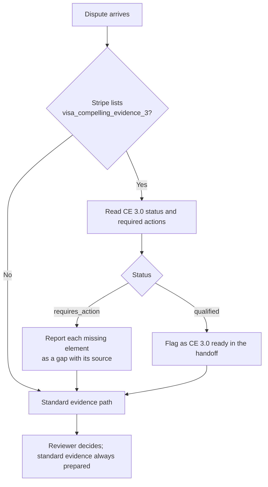

# Visa Compelling Evidence 3.0: scope decision

Visa Compelling Evidence 3.0 (CE 3.0) lets a merchant answer a "fraud, card-absent" dispute by showing a history of undisputed purchases by the same customer. It targets friendly fraud: a genuine customer who disputes a purchase they made. For online retailers this is one of the most valuable defences, and also one of the easiest to get wrong, because eligibility depends on exact rules about earlier transactions.

Source: Stripe, *Visa Compelling Evidence 3.0 disputes* (`stripe_visa_ce3`, captured 6 October 2026), with Visa's *Dispute Management Guidelines*, chapter 4 "Providing Compelling Evidence" (June 2024).

## Eligibility, as published

| Requirement | Rule |
|---|---|
| Network and reason | Visa, network reason code **10.4** (other fraud, card-absent) |
| Prior history | At least **two** earlier transactions with the **same payment method**, not disputed |
| Timing | Earlier transactions **120–364 days** before the disputed one |
| Quality of history | Earlier transactions paid and undisputed; validation charges do not count |
| Descriptions | Product descriptions for the disputed and earlier transactions; disputed transaction marked `merchandise` or `services` |
| Matching evidence | All three transactions share **two main elements**, or **one main and one secondary** |
| Main elements | Customer purchase IP; device fingerprint *or* device ID |
| Secondary elements | Shipping address; customer email; customer account ID |
| Invalid combination | Device fingerprint together with device ID |
| Processor | Stripe must have processed the earlier transactions |

Stripe reports eligibility on the dispute (`enhanced_eligibility_types`) and progress in `evidence_details.enhanced_eligibility.visa_compelling_evidence_3` (`requires_action` with `required_actions`, or `qualified`). After submission the status becomes `qualified` or `not_qualified`; a non-qualifying submission still goes through as standard evidence.

## Supported and unsupported cases

| Case | Outcome | Basis |
|---|---|---|
| Visa 10.4 with two qualifying earlier Stripe transactions and matching elements | **Eligible** | Published criteria |
| Visa 10.4 test dispute created with Stripe's CE 3.0 test card | **Eligible** | Observed: `reason: fraudulent`, `network_reason_code: 10.4`, `enhanced_eligibility_types: ["visa_compelling_evidence_3"]` |
| Visa 13.1 product not received (both integration disputes) | **Not eligible** | Observed: `enhanced_eligibility_types: []`, reason code 13.1 |
| Mastercard or American Express disputes | **Not applicable** | CE 3.0 is a Visa programme |
| Earlier purchases processed outside Stripe | **Not supported** | Stripe requires it processed the prior transactions |
| Only one earlier purchase, or earlier purchases under 120 or over 364 days old | **Not eligible** | Published criteria |
| Earlier "purchases" that were card validation charges | **Not eligible** | Published criteria |
| Matching on device fingerprint and device ID only | **Not eligible** | Invalid combination |

## Decision for the first release

- **Detect and explain, do not submit CE 3.0 yet.** The agent reads Stripe's eligibility fields, reports whether a dispute qualifies, lists required actions as evidence gaps and cites the rule. Preparing and submitting the nested `enhanced_evidence` object is deferred until a fraud scenario has been evaluated. The submission tool accepts only standard text fields today, so an unreviewed CE 3.0 payload cannot be sent.
- **Always prepare standard evidence as well.** Stripe falls back to standard evidence if a CE 3.0 submission does not qualify, so the standard pack is never optional.
- **Use the provider's eligibility signal; verify it rather than recompute it.** Stripe attempts to autofill CE 3.0 evidence from earlier transactions. The agent checks the autofilled elements against the merchant's records and flags conflicts, rather than building a parallel eligibility engine.
- **Reason for sequencing.** The first segment's initial cases are not-received, duplicate and refund disputes. CE 3.0 is high-value for fraud disputes, so it is the first expansion once a 10.4 scenario exists in the evaluation set.
